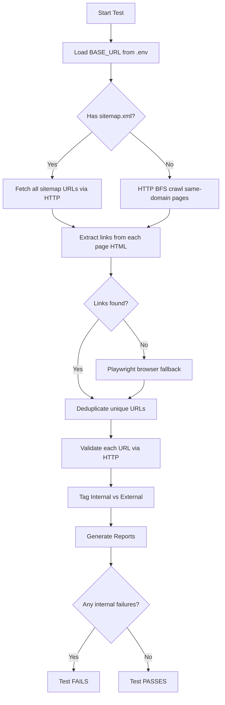

# WebSite Automation Framework — Manager Overview

**Purpose:** Automatically scan a website, find all pages and links, check whether each link works, and produce easy-to-read reports. The test **fails only when broken links are on your own website** (internal links). External third-party link issues are logged for reference but do not fail the test.

**Current target site:** Configured via `BASE_URL` in `.env` (e.g. `https://venturevp.com/`)

---

## 1. What This Framework Does (In Simple Terms)

| Step | What happens |
|------|----------------|
| 1. **Discover pages** | Finds all pages on the website (via sitemap or crawl) |
| 2. **Extract links** | Reads every link on every page (URL, button text, page title) |
| 3. **Validate links** | Sends HTTP requests to each unique link and records the status code |
| 4. **Generate reports** | Creates JSON, HTML, and failed-links reports for review |
| 5. **Pass / Fail** | Test **passes** if no internal broken links; **fails** if any internal link returns an error (404, 500, etc.) |

**Why it matters:** Catches broken navigation, dead “Learn More” buttons, and bad internal URLs before users or clients find them.

---

## 2. High-Level Architecture

```
┌─────────────────────────────────────────────────────────────────────────┐
│                         .env  (BASE_URL only)                           │
└─────────────────────────────────────────────────────────────────────────┘
                                    │
                                    ▼
┌─────────────────────────────────────────────────────────────────────────┐
│              Playwright Test Runner  (brokenLinks.spec.ts)              │
│                    Orchestrates the full workflow                       │
└─────────────────────────────────────────────────────────────────────────┘
                                    │
          ┌─────────────────────────┼─────────────────────────┐
          ▼                         ▼                         ▼
┌──────────────────┐   ┌──────────────────────┐   ┌──────────────────────┐
│  SITE DISCOVERY  │   │   LINK EXTRACTION    │   │   LINK VALIDATION    │
│                  │   │                      │   │                      │
│ 1. Sitemap.xml   │──▶│ Cheerio HTML parser  │──▶│ HTTP HEAD/GET checks │
│ 2. HTTP BFS crawl│   │ Page title + anchor  │   │ 50 parallel requests │
│ 3. Playwright    │   │ text per link        │   │ Internal vs External │
│    (fallback)    │   │                      │   │                      │
└──────────────────┘   └──────────────────────┘   └──────────────────────┘
                                    │
                                    ▼
┌─────────────────────────────────────────────────────────────────────────┐
│                         REPORT GENERATOR                                │
│  • BrokenLinkReport.json   (full data)                                  │
│  • BrokenLinkReport.html   (all links — pass + fail)                    │
│  • failed-links.log        (failures only — text)                       │
│  • failed-links.html       (failures only — browser-friendly)           │
└─────────────────────────────────────────────────────────────────────────┘
```

### Discovery strategy (fast → slow)

1. **Sitemap first** — If `sitemap.xml` exists, use it to get the page list (fastest).
2. **HTTP crawl** — If no sitemap, crawl same-domain pages via HTTP (no browser).
3. **Playwright fallback** — If HTTP finds no links (e.g. heavy JavaScript site), use a real browser.

---

## 3. End-to-End Flow



---

## 4. Project Folder Structure

```
WebSite Automation/
│
├── .env                          ← Only file users edit (BASE_URL)
├── .env.example                  ← Template for new setups
├── package.json                  ← Dependencies and npm scripts
├── playwright.config.ts          ← Playwright test settings
├── tsconfig.json                 ← TypeScript configuration
│
├── src/                          ← Framework source code
│   ├── config/
│   │   └── environment.ts        ← Loads BASE_URL, timeouts, concurrency
│   ├── core/
│   │   └── BasePage.ts           ← Base Page Object (for future page tests)
│   ├── models/
│   │   └── LinkResult.ts         ← Data types (link results, discovery)
│   └── utilities/
│       ├── SiteDiscoveryService.ts    ← Main discovery orchestrator
│       ├── SitemapDiscovery.ts        ← Reads sitemap.xml
│       ├── HttpPageCrawler.ts         ← HTTP page fetch + BFS crawl
│       ├── HtmlLinkExtractor.ts       ← Parses HTML for links + titles
│       ├── PlaywrightFallbackCrawler.ts ← Browser crawl when HTTP fails
│       ├── LinkExtractor.ts           ← URL helpers (resolve, ignore rules)
│       ├── LinkValidator.ts           ← HTTP validation + internal/external
│       ├── ReportGenerator.ts         ← JSON, HTML, failed-links reports
│       └── ProgressLogger.ts          ← Console progress output
│
├── tests/
│   └── brokenLinks/
│       └── brokenLinks.spec.ts   ← Main test — entry point for automation
│
├── reports/                      ← Generated after each run (git-ignored)
│   ├── BrokenLinkReport.json
│   ├── BrokenLinkReport.html
│   ├── failed-links.log
│   └── failed-links.html
│
└── docs/
    ├── Framework-Manager-Overview.md      ← This document
    └── Technical-Design-Implementation-Summary.md  ← Detailed technical doc
```

---

## 5. Key Files — What Each One Does

### Configuration

| File | Role |
|------|------|
| `.env` | **Single setting:** `BASE_URL` — the website to test |
| `src/config/environment.ts` | Loads config; defines timeouts and concurrency (20 page fetches, 50 validations) |
| `playwright.config.ts` | Test runner settings (35 min timeout, Chromium browser) |

### Test entry point

| File | Role |
|------|------|
| `tests/brokenLinks/brokenLinks.spec.ts` | **Main test.** Runs discovery → validation → reports → pass/fail |

### Discovery (find pages)

| File | Role |
|------|------|
| `SiteDiscoveryService.ts` | Coordinates sitemap → HTTP → Playwright pipeline |
| `SitemapDiscovery.ts` | Fetches and parses `sitemap.xml` |
| `HttpPageCrawler.ts` | Downloads pages in parallel; BFS crawl when no sitemap |
| `PlaywrightFallbackCrawler.ts` | Browser-based crawl for JS-heavy sites |

### Link extraction

| File | Role |
|------|------|
| `HtmlLinkExtractor.ts` | Uses Cheerio to parse `<a href>`, page `<title>`, anchor text |
| `LinkExtractor.ts` | URL normalization, same-domain checks, skip mailto/tel/# |

### Validation

| File | Role |
|------|------|
| `LinkValidator.ts` | HTTP HEAD/GET per URL; marks PASS (200/301/302) or FAIL; tags internal/external |

### Reporting

| File | Role |
|------|------|
| `ReportGenerator.ts` | Writes all four report files |
| `ProgressLogger.ts` | Live console output during the run |

### Data model

| File | Role |
|------|------|
| `LinkResult.ts` | Types for link results, discovery method, internal/external |

---

## 6. Reports Generated

After every test run, four reports are created in the `reports/` folder:

| Report | Format | Best for |
|--------|--------|----------|
| `BrokenLinkReport.json` | JSON | Automation, integrations, raw data |
| `BrokenLinkReport.html` | HTML | Full audit — every link (pass + fail) |
| `failed-links.log` | Text | Quick copy/paste, CI logs |
| `failed-links.html` | HTML | **Sharing with managers** — failures only, styled tables |

### What each failed link shows

- **Type** — Internal or External  
- **URL** — The broken link  
- **Status** — HTTP code (e.g. 404, 403, 500)  
- **Link Text** — Button or anchor text (e.g. "Learn More")  
- **Source Page** — Page title where the link was found  
- **Source URL** — Exact page URL  
- **Also on** — Other pages with the same broken link  

### Pass / fail rules

| Link type | Broken link? | Test result |
|-----------|--------------|-------------|
| **Internal** (same domain) | Yes | **Test FAILS** — must be fixed |
| **External** (other sites) | Yes | Logged only — test can still **PASS** |

---

## 7. Setup Instructions

### Prerequisites

- **Node.js** 18 or later ([https://nodejs.org](https://nodejs.org))
- **npm** (included with Node.js)
- Internet access to reach the target website

### First-time setup

```bash
# 1. Open project folder
cd "WebSite Automation"

# 2. Install dependencies
npm install

# 3. Install Playwright browser (Chromium)
npx playwright install chromium

# 4. Create environment file
copy .env.example .env

# 5. Edit .env and set your website URL
#    BASE_URL=https://your-website.com/
```

### `.env` example

```env
BASE_URL=https://venturevp.com/
```

**Only `BASE_URL` needs to be changed** to test a different website.

---

## 8. How to Run

| Command | Description |
|---------|-------------|
| `npm run test:broken-links` | **Main command** — full broken link scan |
| `npm run test:headed` | Same test with visible browser (debugging) |
| `npm run test` | Run all Playwright tests |
| `npm run report` | Open Playwright HTML report from last run |

### Typical run (venturevp.com)

- ~72 pages discovered via sitemap  
- ~90+ unique links validated  
- ~25–35 seconds total runtime  
- Reports written to `reports/`  

### Console output includes

- Pages discovered  
- Links validated  
- Internal vs external failure counts  
- Paths to all generated reports  

---

## 9. Framework Settings (Built-in, No .env Edit Needed)

| Setting | Value | Meaning |
|---------|-------|---------|
| Crawl timeout | 30 minutes | Max time to discover pages |
| Page fetch concurrency | 20 | Pages downloaded in parallel |
| Validation concurrency | 50 | Links checked in parallel |
| HTTP request timeout | 10 seconds | Per-link request limit |
| Pass status codes | 200, 201, 202, 301, 302 | Treated as working links |
| Test timeout | 35 minutes | Max total test duration |

---

## 10. Technology Stack

| Technology | Used for |
|------------|----------|
| **Playwright** | Test runner; browser fallback for JS sites |
| **TypeScript** | Type-safe framework code |
| **Axios** | HTTP requests to validate links |
| **Cheerio** | Fast HTML parsing (no browser needed) |
| **fast-xml-parser** | Read sitemap.xml |
| **p-limit** | Control parallel request limits |
| **dotenv** | Load `.env` configuration |

---

## 11. Design Patterns Used

| Pattern | Where | Benefit |
|---------|-------|---------|
| **Page Object** | `BasePage.ts` | Reusable page helpers for future tests |
| **Utility / Service layer** | `src/utilities/` | Clear separation: discovery, validation, reporting |
| **Orchestrator** | `SiteDiscoveryService.ts` | One place controls discovery strategy |
| **Data models** | `LinkResult.ts` | Consistent structure across reports |

---

## 12. Example: Real Finding (venturevp.com)

| Field | Value |
|-------|-------|
| Type | **Internal** |
| URL | `https://venturevp.com/events/` |
| Status | **404** |
| Link Text | Learn More |
| Source Page | In the Community \| Venture Visionary Partners |
| Source URL | `/in-the-community` |

**Action:** Fix or remove the "Learn More" link, or create the `/events/` page. Until fixed, the test will fail (by design).

External failures (e.g. third-party news sites returning 403 to bots) are listed in `failed-links.html` for awareness but do not fail the test.

---

## 13. Quick Reference for Managers

| Question | Answer |
|----------|--------|
| What do we need to change for a new site? | Only `BASE_URL` in `.env` |
| How long does a run take? | Usually under 1 minute for medium sites; up to 30 min max |
| What report should I open? | **`reports/failed-links.html`** — failures only, easy to read |
| When does the test fail? | Only when **internal** (on-site) links are broken |
| Can we run this in CI/CD? | Yes — `npm run test:broken-links` exits with fail code if internal links break |
| Who maintains the framework? | QA / Dev — code in `src/` and `tests/` |

---

## 14. Support & Next Steps

- **Technical details:** See `docs/Technical-Design-Implementation-Summary.md`  
- **Change target website:** Edit `.env` → `BASE_URL`  
- **Review failures:** Open `reports/failed-links.html` in a browser  
- **Re-run after fixes:** `npm run test:broken-links`  

---

*Document version: 1.0 — WebSite Automation Framework*
